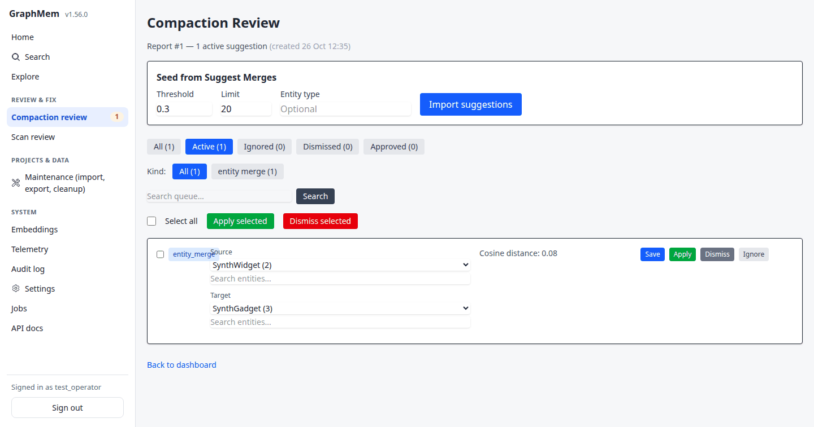

# GraphMem web UI guide

A tour of the web UI for the **operator** (the graph's owner, full access) and the optional **read-only guest**, as of 1.56.0. It covers signing in, the app shell, each section, the guest account and the usual problems.

The screenshots come from a test instance with synthetic data (`Alpha Service`, `SynthWidget`, `SynthGadget`). The image files are in [`docs/images/ui/`](../images/ui/).

- [Signing in](#signing-in)
- [The app shell](#the-app-shell)
- [A tour for the operator](#a-tour-for-the-operator)
- [The read-only guest](#the-read-only-guest)
- [Security notes](#security-notes)
- [Troubleshooting](#troubleshooting)

## Signing in

Open `/operator/login`. The operator and the guest use the same form.

- **Operator credentials:** `OPERATOR_USERNAME` / `OPERATOR_PASSWORD`, or Rails credentials `operator.username` / `operator.password`. The defaults are `operator` / `changeme`.
  - In production, the login page returns `503` ("Configuration required") until the password is changed from `changeme`.
- **Rate limit:** 10 sign-in attempts per 3 minutes per IP. After that the form answers "Too many sign-in attempts".
- **Session lifetime:**

  | Account | Idle timeout | Absolute timeout |
  |---|---|---|
  | Operator | 24 hours | 7 days |
  | Guest | 2 hours | 24 hours |

  An expired session sends you back to the sign-in page with "Your session has expired". Pages you open while signed out bring you back to that page after sign-in.

## The app shell

Every page sits in the same shell:
- **Sidebar** on the left.
- **Toasts** in the top-right corner. Notices disappear after about 6 seconds; alerts stay until you press **×**.
- **Skip to content** link for keyboard users (press Tab on any page to reveal it).

The sidebar groups the pages into five sections and highlights the page you're on.

| Section | Item | What it is |
|---|---|---|
| — | **Home** | Operator dashboard: graph counts, compactor, garbage collector, embeddings, MCP clients, project scans |
| — | **Search** | Text or vector search over entities |
| — | **Explore** | The interactive graph (Cytoscape) |
| Review & Fix | **Compaction review** | Suggestions from dream-state compaction. The badge shows how many are active (refreshed every 30 s) |
| Review & Fix | **Scan review** | Suggestions from project scans |
| Projects & Data | **Maintenance** | Import, export and cleanup |
| System | **Embeddings** | Vector coverage, connection test, backfill, ANN indexes |
| System | **Telemetry** | MCP tool volume, errors, latency |
| System | **Audit log** | Change history for entities, observations and relations |
| System | **Settings** | Feature flags, backups, embeddings, summaries, imports, project scans, telemetry/retention |
| System | **Jobs** | Mission Control for the Solid Queue jobs (its own layout) |
| System | **API docs** | Swagger UI for `/api/v1` (its own page) |

The bottom of the sidebar shows who is signed in, and the **Sign out** button.

**Small screens.** Below 1024 px the sidebar becomes a top bar. The ☰ button opens and closes the menu, and Escape closes it.

| Menu closed | Menu open |
|---|---|
|  |  |

## A tour for the operator

### Home

The dashboard shows the graph's size and the state of the background work. Most cards have their own buttons:
- **Start / Resume** the compactor;
- **Run now** for the garbage collector;
- **Manage embeddings**;
- **Start scan** for a project.

The scheduling and the meaning of each counter are in [dream_state.md](../dream_state.md) and [garbage_collector.md](../garbage_collector.md).

### Search

Type a query and pick **Text** or **Vector**.
- **Vector** needs a working embedding service. It shows "(unavailable)" when vectors are off.
- Each result links to the entity in Explore.

### Explore

The graph starts in **Root View**, which shows the project roots. **Full Graph** shows every entity.
- **Hover** a node for a tooltip.
- **Double-click** a node to open its neighbourhood.
- **Right-click** a node for its menu:
  - **Observations: N** opens the observation cards. A **Delete All Duplicates** button appears when there are duplicates.
  - **Edit data**;
  - **Toggle relations**, **Toggle observations**;
  - **Delete**.
- **Right-click** an edge for **Edit Type** and **Delete Relation**.

**Drag one node onto another** to open the Node-to-Node Action menu:
- **Merge Nodes** merges the dragged node into the target.
- **Create Relation** creates a relationship between the nodes.
- **Cancel** puts the node back.

### Review & Fix

**Compaction review** lists the suggestions that dream-state compaction queued for a decision: such as merges, orphan parents, relationship proposals and relation-integrity fixes. **Scan review** is the same page for project-scan suggestions.

**Finding rows:**
- Filter by status (**All**, **Active**, **Ignored**, **Dismissed**, **Approved**) and by kind, or search the queue.
- **Seed from Suggest Merges** imports fresh merge candidates (threshold, limit, entity type).

**Row buttons:**
- **Save** keeps your edits to the row (for example a different merge target or relation type).
- **Apply** carries out the suggestion. It asks for confirmation.
- **Dismiss** rejects it. A dismissed suggestion stays suppressed, so compaction doesn't propose it again.
- **Ignore** snoozes it. An ignored suggestion can come back after its row is pruned.
- **Restore** returns a dismissed or approved row to active.

**Bulk actions:** **Apply selected** / **Dismiss selected** act on the ticked rows.

**Pruning:** approved, dismissed and ignored rows are deleted every day once they're older than the retention set in **Settings › Telemetry** (`compaction_review_row_retention_days`, 30 days by default).

### Projects & Data

**Maintenance** has three cards:
- **Export**: tick root entities and download them, with their descendants, as JSON.
- **Import**: upload a GraphMem JSON export. You get a review page with a match/create decision per node, then a report.
- **Cleanup**: orphan counts and pointers to the garbage-collector diagnostics.

### System

- **Embeddings**: see the [operator embeddings guide](../operator/embeddings.md).
- **Telemetry**: see [operator tool telemetry](../operator/telemetry.md).
- **Audit log**: browse changes by action, record type, actor, record id and time window.
- **Settings**: every runtime setting is described in the [app settings reference](../app_settings_reference.md). Each tab has its own **Save** button.
- **Jobs**: Mission Control shows queues, failed jobs (retry or discard), workers and recurring tasks. It opens as a full page with its own navigation; **Back to main app** returns to the shell.
- **API docs**: Swagger UI for the REST API, with its own page.

## The read-only guest

The guest account lets someone else browse the graph without being able to change anything.

### Turning it on

1. **Set a guest password**, either as `GRAPH_MEM_GUEST_PASSWORD` or as Rails credentials `guest.password`.
   - The username defaults to `guest`; override it with `GRAPH_MEM_GUEST_USERNAME` or `guest.username`.
   - ENV wins over credentials, and a blank ENV value counts as unset.
2. **Restart the app.** The guest credentials are read once per process.
3. **Check the boot log line:**
   - `[guest access] configured` means it's on.
   - `[guest access] not configured (no guest password)` means no password was found.
   - `[guest access] disabled: guest username or password equals the operator's` means the guest clashes with the operator. The guest's username and password must both differ from the operator's.

**Settings › Feature Flags › Guest access (read-only)** switches the guest on and off without a restart. It's on by default, but it has no effect until a password is set.

### What a guest sees

The guest gets **Search** and **Explore**, a **Read-only guest** badge, and **Sign out**. After sign-in a guest always lands on Search.

In **Explore**, the guest can browse, open neighbourhoods, toggle relations and observations, and read observation cards. There are no edit or delete items, no duplicate-delete button and no drag-and-drop.

Every other page answers with **Operator only** (HTTP 403), including Home, Review, Maintenance, Settings, Jobs and the Audit log. API docs answers 404.

**Guest limits:**
- **Search rate:** up to 60 searches a minute per IP, page and API combined. After that, a "Too many searches" page or a `429`.
- **API:** only the read endpoints that Search and Explore use. Every other `/api/v1` endpoint returns `403`. The list is in [mcp_access_control.md](../mcp_access_control.md#http-api-apiv1).
- **No MCP:** `/mcp*` ignores browser sessions, so a guest cookie never grants MCP access.
- **No project scoping:** a guest can read all graph content.

### Turning it off

Turn **Guest access** off in Settings, or change or remove the guest password and restart. Either way, signed-in guests are sent to the sign-in page on their next click, with "Guest access is disabled."

## Security notes

- **Content Security Policy:** it's enforced.
  - Scripts must carry the per-request nonce, and there are no inline scripts or inline event handlers.
  - Violations are reported to `/csp-reports` and logged as `[CSP] violation report`.
  - Swagger UI at `/api-docs` keeps rswag's own policy.
- **Guest enforcement is server-side.** Hiding buttons is only cosmetic.
  - Every controller action is operator-only unless it explicitly allows guests.
  - The route-matrix spec (`spec/requests/role_matrix_spec.rb`) walks every route to keep it that way.
- **MCP and the REST API** have their own access control (network allowlist and bearer token). See [mcp_access_control.md](../mcp_access_control.md).

## Troubleshooting

| Symptom | Cause and fix |
|---|---|
| "Too many sign-in attempts" | 10 attempts in 3 minutes from your IP. Wait a few minutes. |
| Production shows "Configuration required" (503) | The operator password is still `changeme`. Set `OPERATOR_PASSWORD` (or credentials `operator.password`) and restart. |
| `guest` + password says "Invalid username or password" | No guest password is configured, the guest clashes with the operator, or Guest access is off. Check the `[guest access]` boot log line and the Settings toggle. |
| A guest is signed out with "Guest access is disabled." | The toggle was turned off, or the guest password changed. |
| A guest sees "Too many searches" | More than 60 searches a minute from that IP. Wait a minute. |
| A guest sees "Operator only" | Expected for every page except Search and Explore. |
| Something on a page doesn't work and the browser console shows "Refused to …" | A Content Security Policy violation. Look for `[CSP] violation report` in the Rails log and report it: new pages must not use inline scripts or `on…=` attributes. |
| The Review badge seems out of date | It's cached for 30 seconds. |
