# GraphMem web UI guide

A tour of the web UI for the **operator** (the graph's owner, full access) and the optional **read-only guest**, as of 1.61.0. It covers signing in, the app shell, each section, the guest account and the usual problems.

The screenshots come from a test instance with synthetic data (`Alpha Service`, `SynthWidget`, `SynthGadget`). The image files are in [`docs/images/ui/`](../images/ui/).

- [Signing in](#signing-in)
- [The app shell](#the-app-shell)
- [A tour for the operator](#a-tour-for-the-operator)
- [The read-only guest](#the-read-only-guest)
- [Security notes](#security-notes)
- [Troubleshooting](#troubleshooting)

## Signing in

Open `/operator/login`. The operator and the guest use the same form.

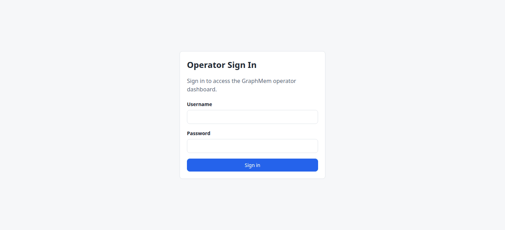

- **Operator credentials:** `OPERATOR_USERNAME` / `OPERATOR_PASSWORD`, or Rails credentials `operator.username` / `operator.password`. The defaults are `operator` / `changeme`.
  - In production, the login page returns `503` ("Configuration required") until the password is changed from `changeme`.
- **Rate limit:** 10 sign-in attempts per 3 minutes per IP. After that the form answers "Too many sign-in attempts".
- **Session lifetime:**

  | Account | Idle timeout | Absolute timeout |
  |---|---|---|
  | Operator | 24 hours | 7 days |
  | Guest | 2 hours | 24 hours |

  An expired session sends you back to the sign-in page with "Your session has expired". Pages you open while signed out bring you back to that page after sign-in.

## The app shell

Every page sits in the same shell:
- **Sidebar** on the left.
- **Toasts** in the top-right corner. Notices disappear after about 6 seconds; alerts stay until you press **×**.
- **Skip to content** link for keyboard users (press Tab on any page to reveal it).

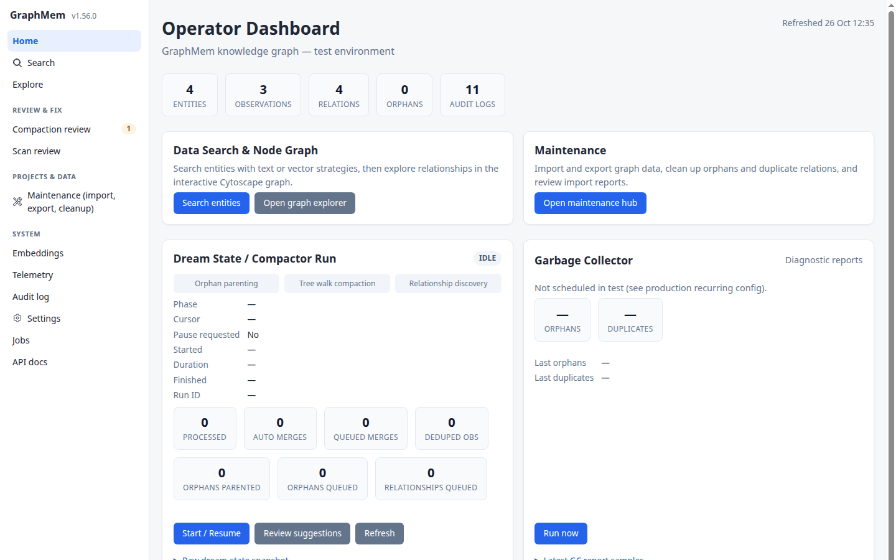

The sidebar lists Home, Search and Explore at the top, then three groups (Review & Fix, Projects & Data, System), and highlights the page you're on.

| Section | Item | What it is |
|---|---|---|
| — | **Home** | Status only: the health strip, graph counts, the review digest, jobs, recent changes, MCP clients, and the quick search |
| — | **Search** | Text or vector search over entities |
| — | **Explore** | The interactive graph (Cytoscape) with the entity panel; the operator edits from both |
| Review & Fix | **Review queue** | Suggestions from compaction, scans and the stale-memory scan, grouped and ranked. The badge counts groups needing attention (refreshed every 30 s) |
| Review & Fix | **Scan review** | The same page, project-scan suggestions only |
| Projects & Data | **Maintenance** | Import, export and cleanup; the compactor, garbage collector and relation repair; project scans; the full MCP clients table |
| System | **Embeddings** | Vector coverage, connection test, backfill, ANN indexes |
| System | **Telemetry** | MCP tool volume, errors, latency |
| System | **Audit log** | Change history for entities, observations and relations |
| System | **Settings** | Feature flags, backups, embeddings, summaries, imports, project scans, telemetry/retention |
| System | **Jobs** | Mission Control for the Solid Queue jobs (its own layout) |
| System | **API docs** | Swagger UI for `/api/v1` (its own page) |

The bottom of the sidebar shows who is signed in, and the **Sign out** button.

**Small screens.** Below 1024 px the sidebar becomes a top bar. The ☰ button opens and closes the menu, and Escape closes it.

| Menu closed | Menu open |
|---|---|
| 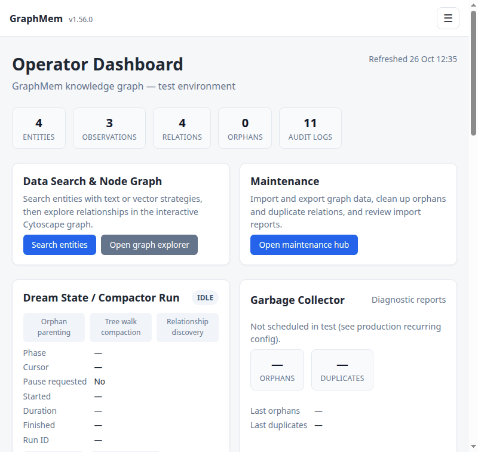 | 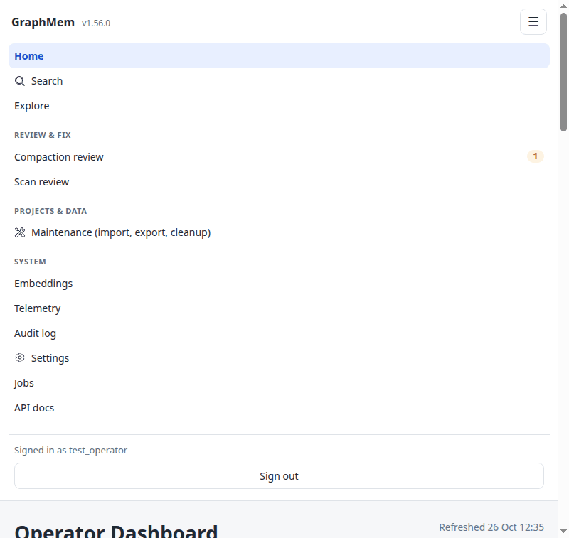 |

## A tour for the operator

### Home

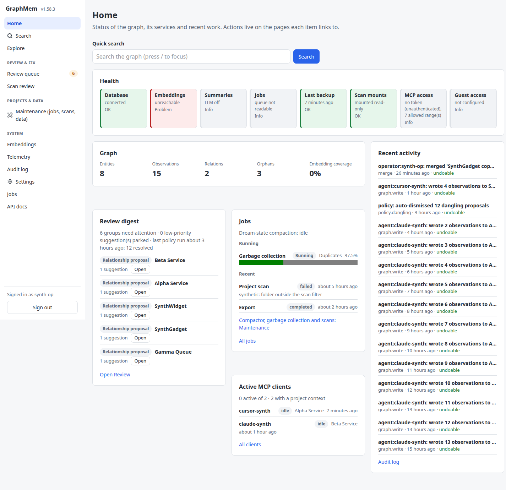

Home shows the state of the graph and its services, and changes nothing: its only form is the
**quick search** (press `/` to focus it). Each widget loads on its own, so a slow check (the
embedding service) never holds up the rest, and each links to the page where you act on it.
- **Health strip:** database; embeddings (service reachable, vector search ready); summaries (LLM
  on or off); jobs (failed count, queue latency); last backup; scan mounts; MCP access mode
  (including Settings › MCP access additions); guest access. Green means fine, amber means check
  it, red means a problem, grey is a choice rather than a problem. Each pill also says it in words.
- **Graph:** entities, observations, relations, orphans and embedding coverage.
- **Review digest:** the top 5 groups needing attention, each with **Open** (the same group on
  Review), and the inbox state with the last policy run. There's no approve or dismiss on Home.
- **Jobs:** what's running (with live progress) and the last finished or failed jobs.
- **Recent activity:** the last 15 change sets, and whether each can still be undone (undo
  itself is on the page that owns the change, such as Review › Resolved).
- **Active MCP clients:** a compact list; the full table is on Maintenance.

The controls that used to be on Home are on **Maintenance** until Review › Generate and the
Projects page arrive: **Start / Resume** and **Pause** for the compactor, **Run now** for the
garbage collector, **Repair relation duplicates**, and the project-scan and guided-scan forms.
The scheduling and the meaning of each counter are in [dream_state.md](../dream_state.md) and
[garbage_collector.md](../garbage_collector.md).

### Search

Search (`/search`, 1.60.0) runs the same search as the agents' MCP `search` tool, so for the same query and filters it lists the same entities in the same order. Every filter lives in the URL: a search can be bookmarked or shared, and Back works. Press `/` to jump to the query box.

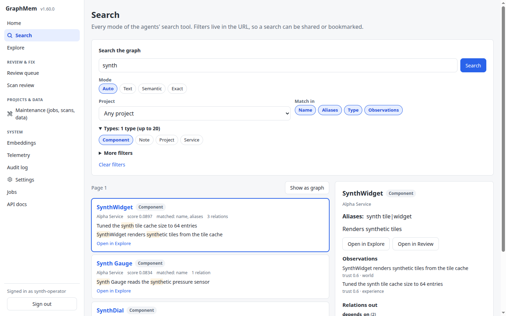

- **Modes:**
  - **Auto** (default): text and semantic ranking together, as agents search.
  - **Text**: names, types and aliases only, with no call to the embedding service.
  - **Semantic**: meaning only, from the embeddings. It's greyed out, with the reason, when vectors aren't available.
  - **Exact**: the name, or one whole alias, equal to the query, by name.
- **Filters** (chips and selects submit straight away):
  - **Project**: that Project and its members.
  - **Match in**: name, aliases, type and observations. Clearing a field stops the query matching it; at least one must stay on.
  - **Types**: one or more entity types.
  - **More filters**: perspective (world facts or work log), occurred after / before, as of, and whether snippets may show obsolete observations.
  - Agents' active project context never changes this page's order; the Project filter is the way to narrow it.
  - An invalid filter or date shows its message above the results.
- **Results**, 20 a page with Previous / Next: name, type, the project it belongs to (or "global"), score and the fields that matched, relation count, and up to two observation snippets with the query's words highlighted (the description when no observation matches). **Open in Explore** opens the entity's neighbourhood.
- **The entity panel**: click a name and its details open beside the list: aliases, description, observations by trust (10 at a time, with **Show obsolete**), and relations both ways grouped by type. Relations open their own panel. The operator also gets **Open in Review**, which searches Review & Fix for the entity, and the same edits as in Explore (below).
- **Show as graph** opens Explore with exactly this page's results and the relations among them (the **From search** scope).
- The old `/search?q=…&strategy=text|vector` links still work (`vector` is Semantic).

### Explore

**Explore** (`/explore`) is the graph canvas, a toolbar above it and the entity panel beside it (the same panel as Search's). The old `/graph` links redirect here, query string included.

- **Toolbar:** **Scope** (Root view: the project roots; Full graph; a project and everything under it; Neighbourhood; From search), **Layout** (force, tree, concentric, grid), **Depth** (1 or 2 hops for a neighbourhood), **Entity type** and **Relation type** filters (they only hide elements, nothing is reloaded), **Fit**, and a link to Search. The scope is kept in the URL, so a reload or a shared link opens the same view.
- **At most 2,000 entities** are drawn at a time. A bigger scope says "Showing 2,000 of N entities; pick a project to see the rest."
- **Click** a node to open its panel; **double-click** to open its neighbourhood; **hover** for a tooltip.
- **Right-click** a node for **Show in panel**, **Open neighbourhood** and **Toggle relations**. The operator also gets **Edit in panel**, **Merge into…** and **Propose deletion** (not for a project root). **Right-click** an edge for its endpoints and type; the operator also gets **Remove relation**.
- **Drag one node onto another** (operator): **Add relation…** opens the type picker (suggested types first, the direction spelled out, **Swap direction**); **Move under…** opens a card with how many entities move and, in amber, any project change; **Merge A into B…** (same type only) opens the merge dialog. **Cancel**, or a click elsewhere, puts the node back.

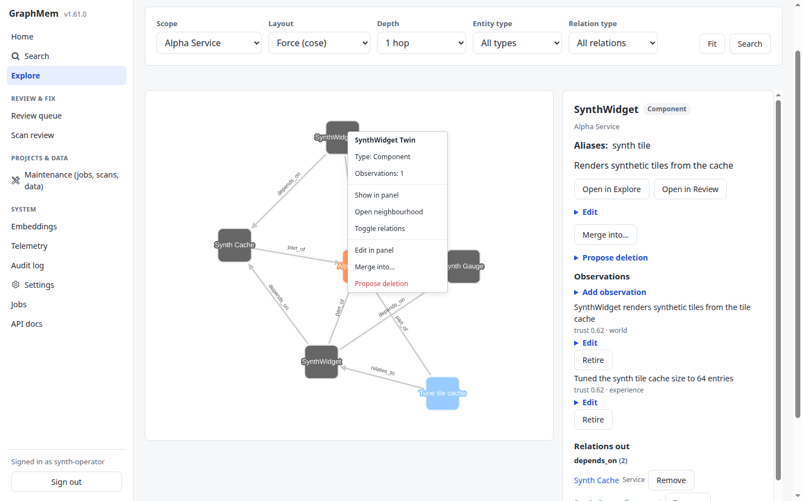

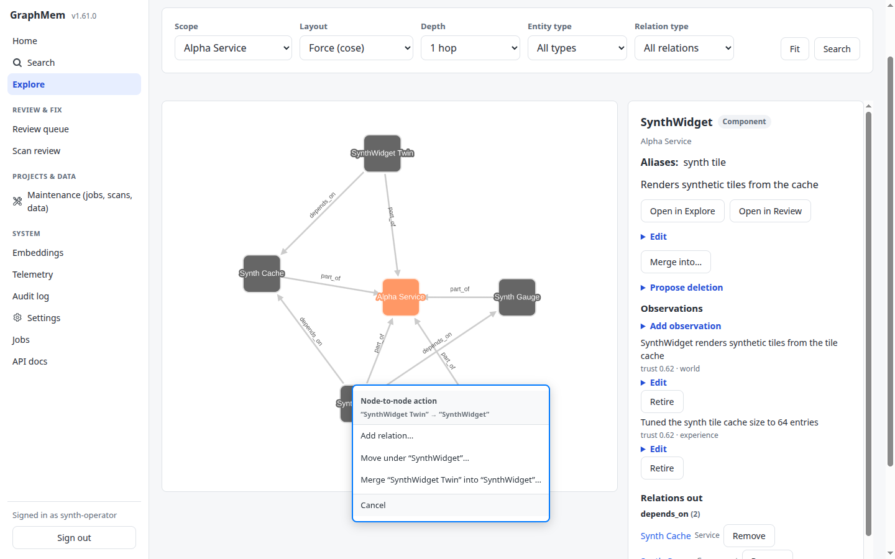

**Editing from the panel (operator):** **Edit** (name, type, aliases, description; a project root only **Rename** and description), **Add observation** (text and perspective), per observation **Edit** (the old text is kept as superseded) and **Retire** (marks it obsolete), per relation **Remove**, **Merge into…**, **Propose deletion**, and **Recent changes**: the last five changes to the entity, each with **Undo** while it can still be undone.
- An exact duplicate observation is refused. A similar one shows "Similar to: …" with **Add anyway**. Without embeddings the similarity check is skipped and the toast says "similarity not checked".
- A name already used in the same project is refused, with the message in the form.
- Project roots can be renamed but not retyped, given aliases, moved, merged or proposed for deletion.

**The merge dialog:** "Merge **A** (source, will be removed) into **B** (survivor)", **Swap direction**, a hint about which one looks canonical, and what the merge will do: the observations that move, the relations re-pointed and dropped, the aliases B gains, the `part_of` children re-parented and any entities that change project, and the open review rows anchored on A (a merge doesn't close them). Different types or a project root disable **Merge** and say why. If the graph changes between the dialog and **Merge**, the merge is refused ("The graph changed since the preview, review it again.") and nothing is written.

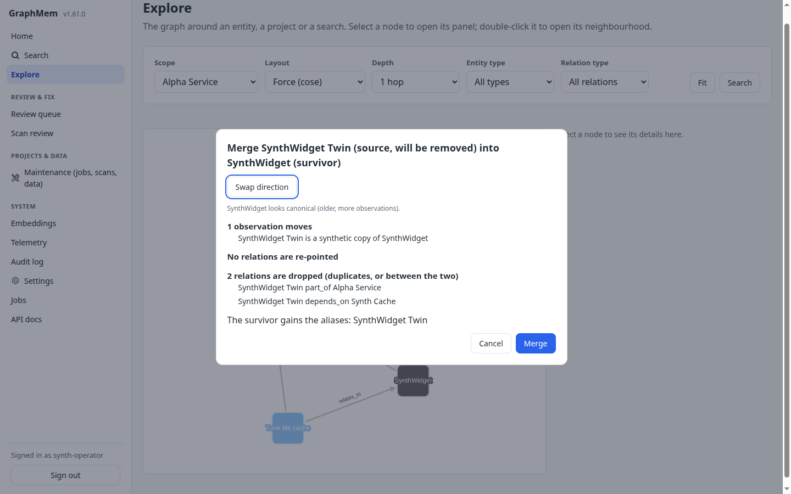

**Every edit is undoable.** Each one is recorded as one change set with you as the actor, shows in Home's recent activity and the panel's Recent changes, and the toast offers **Undo** for 10 minutes. After that the toast says "Undo it later from Home › Recent activity"; the change stays undoable for 30 days (7 for a merge).

**Explore never deletes.** There is no delete and no "delete duplicates" here. **Propose deletion** adds a delete suggestion to **Review & Fix** (Scan review) with an optional reason and links to it; proposing the same entity again links to the pending suggestion.

### Review & Fix

**Review & Fix** (`/review`) gathers the suggestions from dream-state compaction, project scans and the stale-memory scan, grouped (one group per entity or pair) and ranked by priority. Ranking uses impact, confidence and age; Project roots and well-connected entities weigh more.

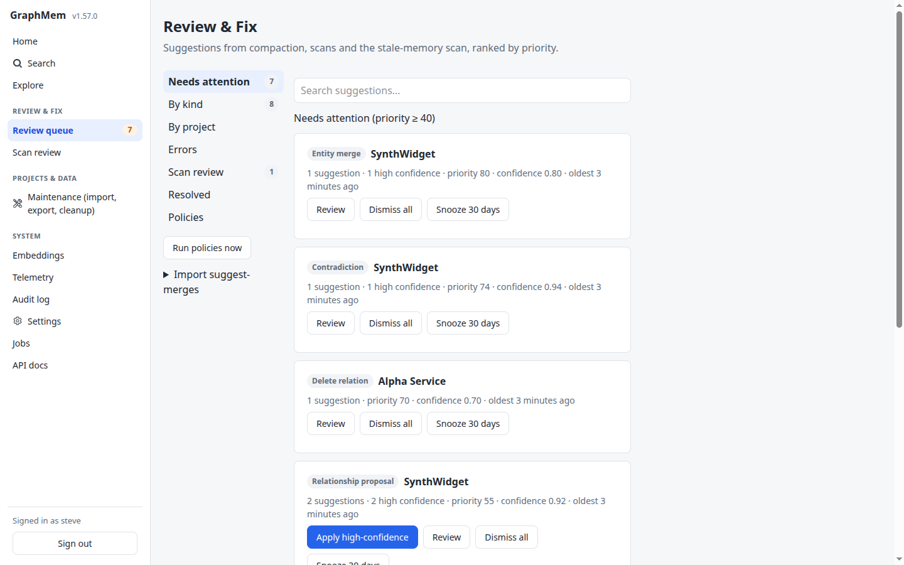

**The rail (left):**
- **Needs attention** (default): at most 10 groups at or above the attention threshold (Settings › Review policies, default 40), each a decision: **Apply high-confidence** (relationship proposals and stale memory only), **Review**, **Dismiss all**, **Snooze 30 days**. Below the cards: how many more groups sit under the threshold. With nothing above it you get **Inbox zero**, the policies' count for the week and the next compaction run.
- **By kind**, **By project**, **Errors**, **Scan review**: the same groups as lines; **Review** opens a group's rows.
- **Resolved**: approved, dismissed and expired suggestions with who resolved them, **Undo** while the change can be undone, otherwise **Restore** and the reason ("can't be undone: entity deleted").
- **Policies**: the latest policy runs with one **Undo** per batch. **Run policies now** and **Import suggest-merges** sit under the rail.

**A suggestion (detail pane, right):** what it is, its edit fields (merge targets, relation type, parent), and **If applied**: the exact effects and how long it stays undoable. **Apply…** opens a confirm card with the same effects. Merges, deletes, moves and reparents are applied one at a time; a deleted entity can't be undone, and the card says so.

**Contradictions:** the two observations side by side; **Keep this** on either side opens the confirm card (the other side is marked obsolete, undoable for 30 days). **Both are right** dismisses the pair for good.

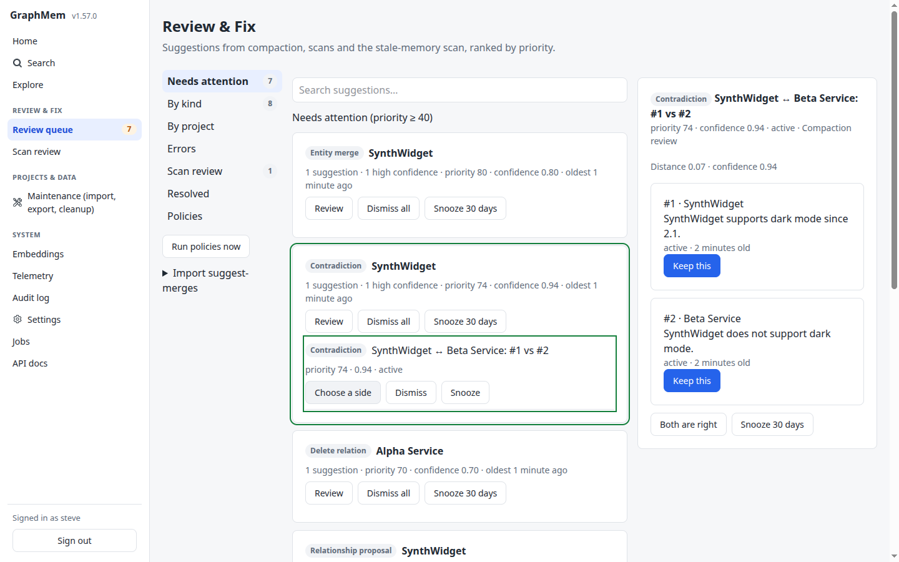

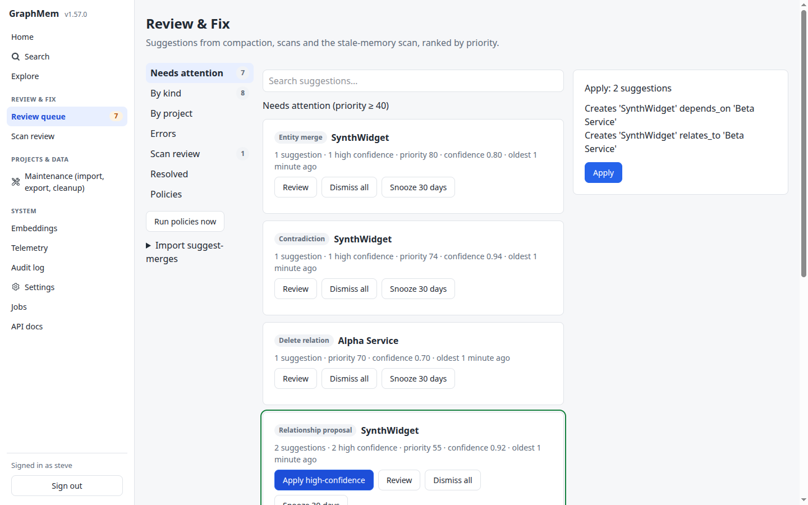

**Group actions** always show a confirm card listing exactly which suggestions are included and which aren't (and why). Group apply takes only relationship proposals and stale-memory rows that aren't snoozed, at most 100, and refuses if the group changed since the card was shown. **Dismiss** suppresses a suggestion for good; **Snooze** hides it for 30 days.

**Undo:** after each action the toast offers **Undo** (it doesn't time out), or says why the change can't be undone. Undo is also in **Resolved** and **Policies**, for 30 days (7 for merges).

**Keyboard:** `j`/`k` next/previous, `Enter` open, `a` apply, `d` dismiss, `s` snooze, `e` save edits, `r` restore, `x` select, `/` search, `1`/`2` keep the first/second side of a contradiction (opens the confirm card), `?` help. Shortcuts don't fire while you type in a field, and `Enter` on a focused button or link presses it.

**Settings › Review policies:** the nightly policies (dismiss dangling suggestions, dismiss stale memory no longer flagged, expire old low-confidence ones; auto-apply high-confidence relationships and expired validity, both off by default), the attention threshold and the backlog ceiling. Out-of-range values are refused; every change is in the audit log.

**Pruning:** approved, dismissed, expired and ignored rows are deleted every day once they're older than the retention set in **Settings › Telemetry** (`compaction_review_row_retention_days`, 30 days by default); a snoozed row is kept until its snooze ends.

### Undo (1.57.0)

Every graph write, merge (including compaction auto-merges), review action and Explore edit is recorded as a change set. The operator can undo one within 7 days for merges, 30 days for everything else: from the toast (Explore's toasts offer it for 10 minutes), from **Review › Resolved** or **Policies**, from an entity panel's **Recent changes**, or with `POST /changes/:uuid/undo`. Sets that hard-delete an entity or observation, or mix a merge with other writes, are recorded but can't be undone. Guests can't undo (403).

### Projects & Data

**Maintenance** has three cards:
- **Export**: tick root entities and download them, with their descendants, as JSON.
- **Import**: upload a GraphMem JSON export. You get a review page with a match/create decision per node, then a report.
- **Cleanup**: orphan counts and pointers to the garbage-collector diagnostics.

### System

- **Embeddings**: see the [operator embeddings guide](../operator/embeddings.md).
- **Telemetry**: see [operator tool telemetry](../operator/telemetry.md).
- **Audit log**: browse changes by action, record type, actor, record id and time window.
- **Settings**: every runtime setting is described in the [app settings reference](../app_settings_reference.md). Each tab has its own **Save** button.
- **Jobs**: Mission Control shows queues, failed jobs (retry or discard), workers and recurring tasks. It opens as a full page with its own navigation; **Back to main app** returns to the shell.
- **API docs**: Swagger UI for the REST API, with its own page.

## The read-only guest

The guest account lets someone else browse the graph without being able to change anything.

### Turning it on

1. **Set a guest password**, either as `GRAPH_MEM_GUEST_PASSWORD` or as Rails credentials `guest.password`.
   - The username defaults to `guest`; override it with `GRAPH_MEM_GUEST_USERNAME` or `guest.username`.
   - ENV wins over credentials, and a blank ENV value counts as unset.
2. **Restart the app.** The guest credentials are read once per process.
3. **Check the boot log line:**
   - `[guest access] configured` means it's on.
   - `[guest access] not configured (no guest password)` means no password was found.
   - `[guest access] disabled: guest username or password equals the operator's` means the guest clashes with the operator. The guest's username and password must both differ from the operator's.

**Settings › Feature Flags › Guest access (read-only)** switches the guest on and off without a restart. It's on by default, but it has no effect until a password is set.

### What a guest sees

The guest gets **Search** and **Explore**, a **Read-only guest** badge, and **Sign out**. After sign-in a guest always lands on Search. On Search the guest gets the same results, panels and **Show as graph** as the operator, without **Open in Review**.

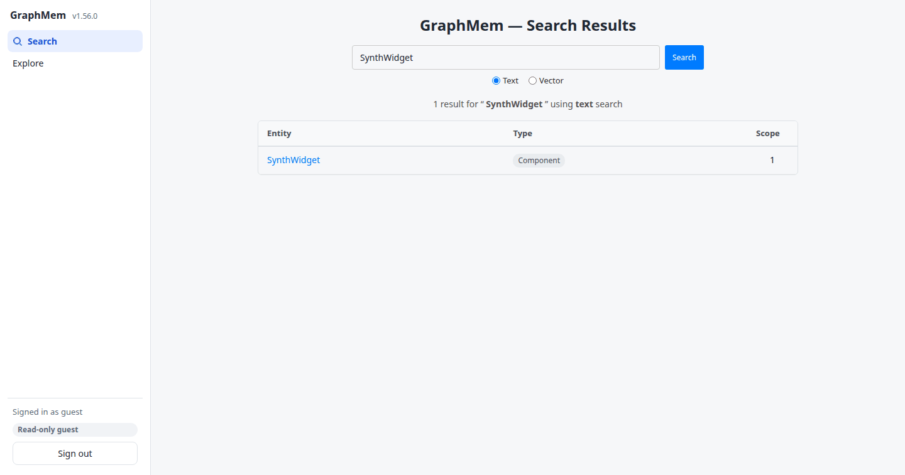

In **Explore**, the guest gets the same canvas, toolbar and panel: browse, pick a scope, open neighbourhoods, toggle relations and read the panel. There are no edit items in the menus, no edit forms in the panel, no Recent changes, and dragging a node only moves it on the screen. Every Explore write answers a guest with 403.

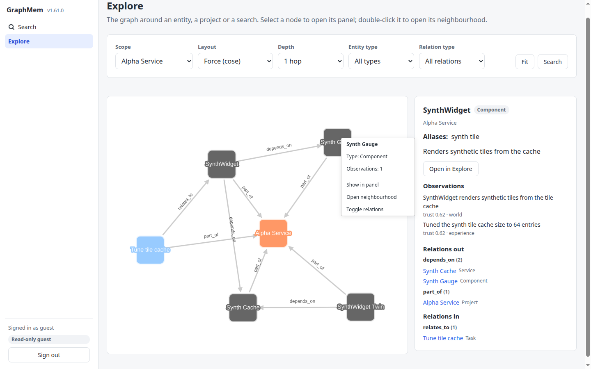

Every other page answers with **Operator only** (HTTP 403), including Review, Maintenance, Settings, Jobs and the Audit log. Home sends a guest to Search, and API docs answers 404.

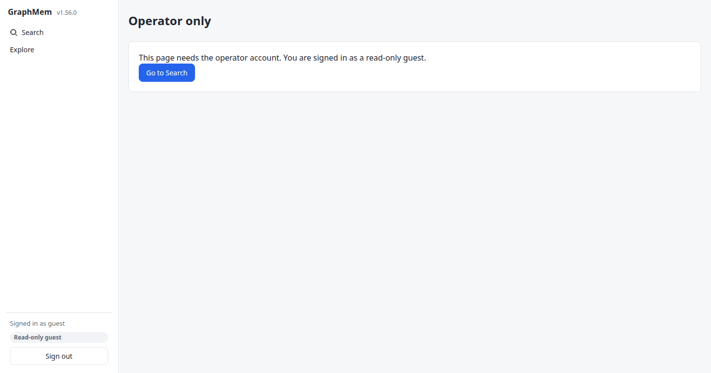

**Guest limits:**
- **Search rate:** up to 60 searches a minute per IP, page and API combined, and 300 a minute across all guests. After that, a "Too many searches" page or a `429` with `Retry-After`. The 300 is shared: one busy guest can use it up for every guest until the minute passes. Opening a result's panel or "Show as graph" doesn't count.
- **API:** only the read endpoints that Search and Explore use. Every other `/api/v1` endpoint returns `403`. The list is in [mcp_access_control.md](../mcp_access_control.md#http-api-apiv1).
- **No MCP:** `/mcp*` ignores browser sessions, so a guest cookie never grants MCP access.
- **No project scoping:** a guest can read all graph content.

### Turning it off

Turn **Guest access** off in Settings, or change or remove the guest password and restart. Either way, signed-in guests are sent to the sign-in page on their next click, with "Guest access is disabled."

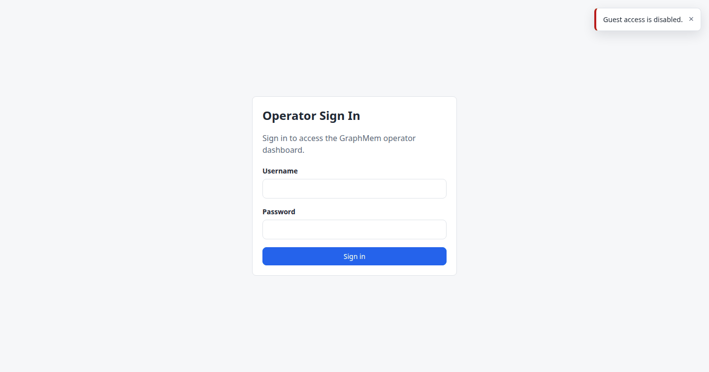

## Security notes

- **Content Security Policy:** it's enforced.
  - Scripts must carry the per-request nonce, and there are no inline scripts or inline event handlers.
  - Violations are reported to `/csp-reports` and logged as `[CSP] violation report`.
  - Swagger UI at `/api-docs` keeps rswag's own policy.
- **Guest enforcement is server-side.** Hiding buttons is only cosmetic.
  - Every controller action is operator-only unless it explicitly allows guests.
  - The route-matrix spec (`spec/requests/role_matrix_spec.rb`) walks every route to keep it that way.
- **MCP and the REST API** have their own access control (network allowlist and bearer token). See [mcp_access_control.md](../mcp_access_control.md).

## Troubleshooting

| Symptom | Cause and fix |
|---|---|
| "Too many sign-in attempts" | 10 attempts in 3 minutes from your IP. Wait a few minutes. |
| Production shows "Configuration required" (503) | The operator password is still `changeme`. Set `OPERATOR_PASSWORD` (or credentials `operator.password`) and restart. |
| `guest` + password says "Invalid username or password" | No guest password is configured, the guest clashes with the operator, or Guest access is off. Check the `[guest access]` boot log line and the Settings toggle. |
| A guest is signed out with "Guest access is disabled." | The toggle was turned off, or the guest password changed. |
| A guest sees "Too many searches" | More than 60 searches a minute from that IP, or 300 across all guests (one shared budget, so another guest's searches count too). Wait a minute. |
| A guest sees "Operator only" | Expected for every page except Search and Explore. |
| Something on a page doesn't work and the browser console shows "Refused to …" | A Content Security Policy violation. Look for `[CSP] violation report` in the Rails log and report it: new pages must not use inline scripts or `on…=` attributes. |
| The Review badge seems out of date | It's cached for 30 seconds. |
