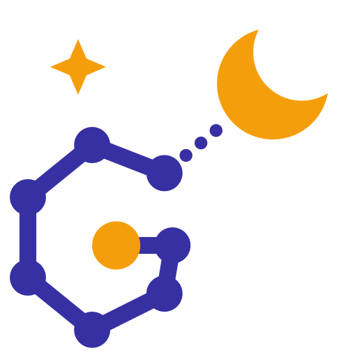

# Quick setup: graph_mem on a new workstation

The shortest path from nothing to a running graph_mem container, plus the skill and the rule
for Claude Code, Cursor and Devin Desktop. Everything else in `docs/` is optional reading.

**You need:** Docker with Compose, git, and [Ollama](https://ollama.com). Linux is the tested
host: the app container uses host networking.

## 1. Clone and configure

```bash
git clone https://github.com/steveoro/graph_mem.git ~/Projects/graph_mem
cd ~/Projects/graph_mem
cp .env.example .env
ollama pull nomic-embed-text
```

Edit `.env` and set (you'll add `RAILS_MASTER_KEY` in the next step):

| Variable | Value |
|---|---|
| `DB_PASSWORD` | Any password for the MariaDB container. |
| `OPERATOR_PASSWORD` | Your password for the web UI. Add the line: the operator login stays disabled while the password is the default `changeme`. |
| `DB_BACKUP_HOST_PATH` | An existing folder for database backups, e.g. `/home/<you>/backups/graph_mem`. |

Leave everything else as it is. `config/database.yml` doesn't need changes: the container gets
its database URL from `.env`.

## 2. Generate your own master key

Every developer generates their own key; nobody needs to share one. The key encrypts
`config/credentials.yml.enc`, and the app needs only a `secret_key_base` from that file (the
operator login comes from `.env`), so a fresh one works just as well. Build the image, then let Rails create a new key and credentials file
inside it (no Ruby needed on the host):

```bash
docker compose build app
rm config/credentials.yml.enc          # git keeps the shared one
docker run --rm --user "$(id -u):$(id -g)" --entrypoint "" -e RAILS_ENV=production -e EDITOR=true \
  -v "$PWD/config:/rails/config" graph_mem-app bin/rails credentials:edit
echo "RAILS_MASTER_KEY=$(cat config/master.key)" >> .env
```

`sh: git: not found` in the output is harmless. The command writes `config/master.key`
(git-ignored) and a new `config/credentials.yml.enc`, so `git status` shows that file as
modified: keep it local and never commit it. Back up `config/master.key`: without it, your
credentials file can't be decrypted.

## 3. Start the container

```bash
bin/up --build                                         # docker compose up -d, plus LAN allowlist detection
docker compose exec app bin/rails db:seed              # first run only: canonical entity types
docker compose exec app bin/rails embeddings:check     # confirms Ollama answers
```

Check: `curl -s localhost:3030/up` returns a green page, and `http://localhost:3030` opens the
graph view. The database is created and migrated on startup.

**After a `git pull`:** `docker compose down && bin/up --build`.

## 4. Connect your agents to the MCP server

Give every agent its own `X-MCP-Client` value: graph_mem keeps one project context per value.

**Claude Code** (once, for all projects):

```bash
claude mcp add --transport http graph_mem http://localhost:3030/mcp \
  --header "X-MCP-Client: claude-code" --scope user
```

**Cursor:** add this to `~/.cursor/mcp.json` (all projects) or `.cursor/mcp.json` (one project):

```json
{
  "mcpServers": {
    "graph_mem": {
      "url": "http://localhost:3030/mcp",
      "headers": { "X-MCP-Client": "cursor" }
    }
  }
}
```

**Devin Desktop:** open its MCP settings, edit the raw config and add the same `graph_mem` block,
with `"X-MCP-Client": "devin"`. Refresh the tool list afterwards.

## 5. Install the skill in each project

In every project where agents should use graph_mem, run from the project root:

```bash
GM=~/Projects/graph_mem
mkdir -p .agents/skills .claude/skills
cp -r "$GM/skills/graph-mem-mcp-toolset" .agents/skills/   # Cursor, Devin Desktop
cp -r "$GM/skills/graph-mem-mcp-toolset" .claude/skills/   # Claude Code
```

Copy the whole folder, `references/` included. To install it once for Claude Code in every
project, copy it to `~/.claude/skills/` instead of `.claude/skills/`.

Optional: also copy `$GM/skills/project-scan` the same way. It scans a project into the graph,
and runs only when you ask for it.

## 6. Add the rule to each project

The rule is ten lines telling the agent when to use the skill. Append it to the project's
`AGENTS.md`, which Cursor and Devin Desktop read:

```bash
printf '\n' >> AGENTS.md && cat "$GM/docs/rules/graph_mem_mcp_rules.md" >> AGENTS.md
```

**Claude Code** reads `AGENTS.md` only when the project has no `CLAUDE.md`. If there is one,
make its first line `@AGENTS.md`:

```bash
[ -f CLAUDE.md ] && ! grep -qx '@AGENTS.md' CLAUDE.md && sed -i '1i @AGENTS.md\n' CLAUDE.md
```

Don't also put the rule in `.cursor/rules/` or `.devin/rules/`: an agent that reads both loads it twice.

## 7. Try it

Start a new agent session in the project and ask: *"call graph_mem get_context"*. A reply with
a context status means the agent is connected. The first time in a project, ask it to set the
context to that project (it creates the Project entity if needed).

## When something goes wrong

| Symptom | Fix |
|---|---|
| App container keeps restarting; `docker compose logs app` mentions the master key or `secret_key_base` | `RAILS_MASTER_KEY` in `.env` doesn't match `config/credentials.yml.enc`: redo step 2. |
| Operator login returns 503 | Set `OPERATOR_PASSWORD` in `.env`, then `docker compose down && bin/up`. |
| `embeddings:check` fails | Ollama isn't running, or `nomic-embed-text` isn't pulled. |
| Agent gets 403 from `/mcp` | It connects from another machine or through a host name not on the allowlist: see [MCP access control](mcp_access_control.md). |
| Agent doesn't list graph_mem tools | Restart the agent or refresh its MCP tools; check the URL ends in `/mcp`. |

More: [troubleshooting](troubleshooting.md), [agent rules and skills](rules/README.md),
[MCP tools](mcp_tools.md), [README](../README.md) (full configuration).
